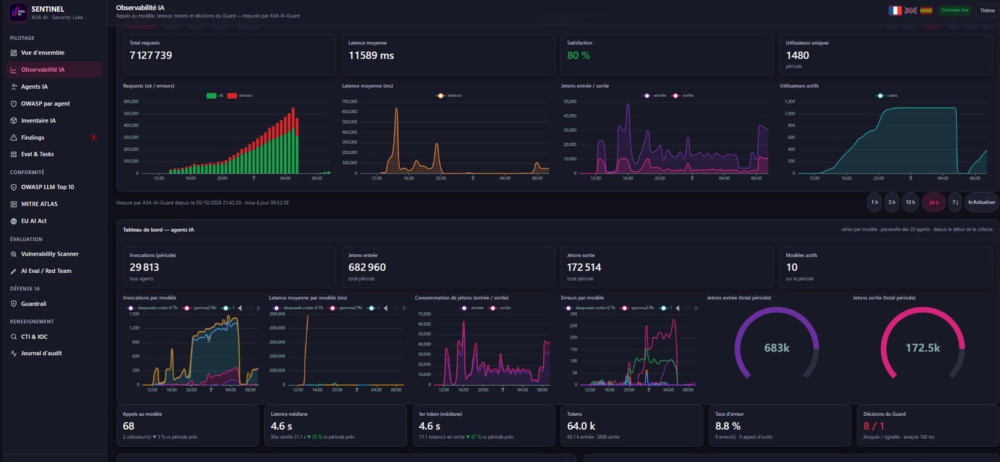

# Green dashboards, broken agents

*October 12, 2026 · ASA AI Agent Observability*

Latency and uptime can look healthy while AI agents fail silently: in this window, 8.8% of model calls errored and our Guard blocked 8 prompts.
ASA AI Agent Observability tracks every call, token, error and Guard decision, per agent and per model, in one live view.
Your team sees errors, token spend and blocked attacks before your users do.
Want a live demo? contact@asa-ai.fr

#AIObservability #LLMOps #OpenTelemetry #AIAgents #AISecurity #GenAI #ASAAI

**Sources:** [Monitor LLM agents in production with Grafana Cloud Agent Observability (DEV Community)](https://dev.to/mr_manushukla/monitor-llm-agents-in-production-with-grafana-cloud-agent-observability-2026-3al9)

Source captures: Screenshot 2026-10-07 093259.png
