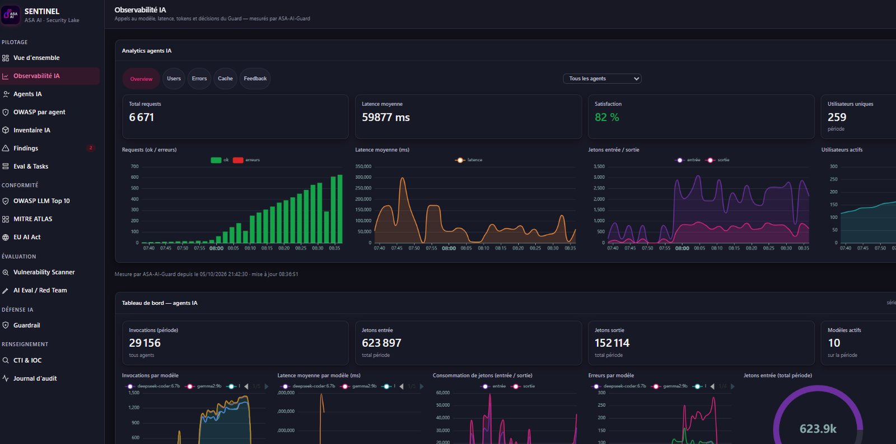
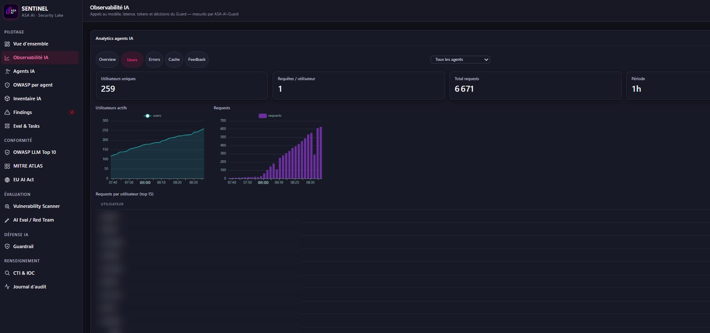

# When traffic surges, averages lie

*October 13, 2026 · ASA AI Agent Observability*

In one hour, traffic on our agents climbed from almost nothing to more than 600 requests per time slot, and the average latency read 59,877 ms, a single number that hides peaks close to 300,000 ms.

ASA AI Agent Observability plots requests, errors, latency, tokens and active users on the same timeline, per agent and per model, so a surge and its side effects show up together.

Your team sees which model slows down when load arrives, and who is driving it, before an average turns into an incident.

## What this dashboard shows

- **A surge in one view:** 6,671 requests in the period, with ok and error bars climbing from near zero before 08:00 to more than 600 per time slot by 08:35.
- **Latency beyond the average:** an average of 59,877 ms next to a latency curve whose peaks approach 300,000 ms, so slow spikes are visible instead of being smoothed away.
- **Token flow, in and out:** 29,156 invocations across all agents and 10 active models, with 623,897 input tokens and 152,114 output tokens over the period.
- **Who is behind the load:** 259 unique users in one hour, active users rising from about 115 to about 260, and a per-user request table (top 15, names blurred here).
- **Quality alongside load:** a satisfaction score of 82%, measured by ASA-AI-Guard, shown in the same header as traffic and latency.

## Why it matters

Practitioner guidance on agent monitoring keeps repeating the same point: measure percentile latency at each step of an agent's workflow, not only the overall average. It also treats token consumption as both a cost signal and a behavioral signal, and recommends tracking input and output tokens and cost per route and per user. A traffic surge is exactly when these signals diverge: the average drifts, a few calls stall for minutes, and token spend follows the new users. That is why SENTINEL's AI observability layer keeps latency curves, per-model breakdowns and per-user activity side by side, whether your models run in the cloud or on your own infrastructure.

**Want a live demo on your own agents?** Write to us at **contact@asa-ai.fr**.

#AIObservability #LLMOps #OpenTelemetry #AIAgents #AISecurity #GenAI #ASAAI

**Sources:** [AI agent observability: what to monitor in production (channel.tel)](https://www.channel.tel/blog/ai-agent-observability-what-to-monitor-production) · [LLM monitoring vs LLM observability (Future AGI)](https://futureagi.com/blog/llm-monitoring-vs-llm-observability-2026)

<!-- source-captures: Screenshot 2026-10-07 083750.png, Screenshot 2026-10-07 083647.png -->
