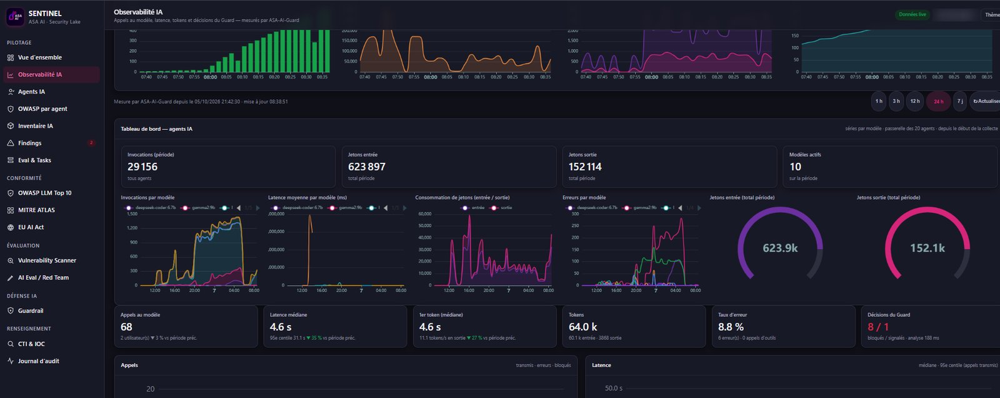

# One model can drag the whole fleet

*October 14, 2026 · ASA AI Agent Observability*

A median latency of 4.6 s looks fine until you see the 95th percentile at 31.1 s, and a latency curve where a single model spikes while the others stay flat.

ASA AI Agent Observability breaks invocations, latency, tokens and errors down per model, across all our agents, so one misbehaving model never hides inside a fleet-wide number.

Your team knows which model to tune, swap or throttle, instead of chasing a vague "the agents are slow".

## What this dashboard shows

- **The fleet in four numbers:** 29,156 invocations across all agents, 623,897 input tokens, 152,114 output tokens and 10 active models over the period.
- **Per-model curves, side by side:** invocations, average latency, token consumption and errors each plotted per model, so the latency spike of one model stands out against flat lines for the others.
- **Median and tail together:** a median latency of 4.6 s next to a 95th percentile of 31.1 s, and a median time to first token of 4.6 s with 11.1 tokens/s on output.
- **Errors with context:** an 8.8% error rate on the latest window (6 errors, 0 tool calls), with the per-model error chart showing which model the errors cluster on over time.
- **Guard in the same view:** ASA-AI-Guard decisions, 8 prompts blocked and 1 flagged, with an analysis time of 188 ms per check.

## Why it matters

As teams route agents across several models, a fleet-wide average stops being useful: the question is which model, which version, which call. That is why the OpenTelemetry GenAI semantic conventions put the model name, token usage and operation duration on every span, even though they are still in development status. Observability practitioners make the same point: a clean dashboard tells you something broke, not why. Breaking every metric down per model is how we turn "slow" into a precise, fixable cause.

**Want a live demo on your own agents?** Write to us at **contact@asa-ai.fr**.

#AIObservability #LLMOps #OpenTelemetry #AIAgents #AISecurity #GenAI #MultiModel #ASAAI

**Sources:** [OpenTelemetry GenAI semantic conventions (Greptime)](https://greptime.com/blogs/2026-05-09-opentelemetry-genai-semantic-conventions) · [LLM monitoring vs LLM observability (Future AGI)](https://futureagi.com/blog/llm-monitoring-vs-llm-observability-2026)

<!-- source-captures: Screenshot 2026-10-07 083920.png -->
